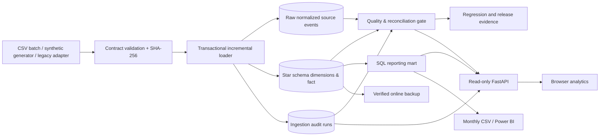
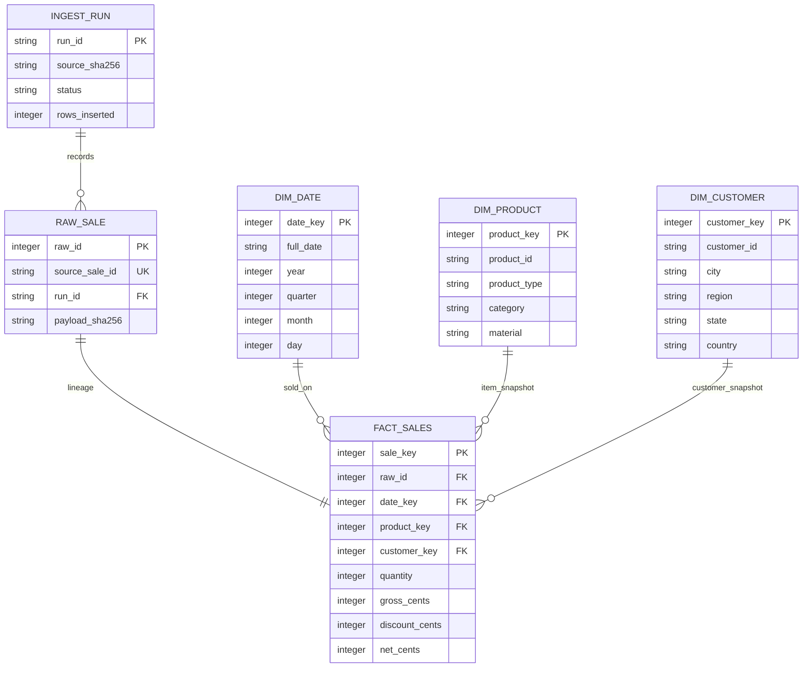

# Furniture Sales Intelligence
**An auditable, end-to-end retail analytics warehouse**  
Portfolio project by **Yasaman Yord** · SQL · Python · SQLite · FastAPI · Business Intelligence · Docker · CI

> An evolution of the original Wholesale Furniture Sales Data Warehouse exercise into a complete, reproducible analytics application. Built to demonstrate the same engineering discipline as [BrokerAssist AI](https://github.com/yasamanyord/brokerassist-ai): a real workflow, verifiable outputs, failure boundaries, and a documented handoff.

[](https://github.com/yasamanyord/Data_Science_Portfolio/actions/workflows/warehouse-checks.yml)
**Status:** locally verified core pipeline and API; synthetic/local portfolio system, not a deployed enterprise warehouse.

## 1. Business problem

A wholesale furniture business needs trustworthy reporting across products, geography, customers, time, revenue and discounts. Raw SQL inserts and manually executed queries can answer isolated questions, but cannot reliably handle recurring data deliveries, duplicate events, incorrect values, historical attribute changes or reproducible KPI definitions.

Furniture Sales Intelligence turns incoming sale-line CSV batches into an auditable dimensional warehouse. Analysts can explore filtered revenue, demand and customer trends through a browser workspace, query the read-only API, export aggregated monthly results for Power BI, and verify that the numbers reconcile to the source.

### What is implemented

| Capability | Implementation |
|---|---|
| Data engineering | Versioned star schema; raw normalized source events; deterministic 5,000-row demo; 50,000-row scale probe |
| ETL pipeline | Strict CSV contract, canonical hashes, transactional incremental loads, audit status and duplicate handling |
| Dimensional modeling | Surrogate date, product and customer keys; immutable event-time descriptive snapshots; one fact per source sale line |
| Financial accuracy | Exact integer USD cents, generated net revenue, schema constraints, explicit denominators for KPIs |
| Analytics | Advanced SQL joins, CTEs, window ranks, calendar year-over-year comparison, repeat customer analysis |
| Consumption | Responsive dashboard, date/category/country filters, read-only FastAPI endpoints, OpenAPI and CSV export |
| Reliability | 51 automated unit/integration/API tests, 10 independent data-quality checks, negative controls and a versioned regression baseline |
| Operations | CLI release gate, health endpoint, batch history, online backup and recovery verification, Windows launcher, Docker Compose and GitHub Actions |
| Original project | Original three SQL scripts retained unchanged; opt-in adapter tested against all 100 original sale rows |

No commercial data, paid API keys, external CRM providers, or cloud accounts are needed for the local demo. This is a conventional deterministic data-engineering project; an LLM is deliberately not put in charge of financial totals.

## 2. Run the end-to-end application

### Windows (recommended)

1. Install **Python 3.12** with the Python launcher.
2. Clone/download this repository and open `Project_1_Data_Warehous`.
3. Double-click [`run_demo.bat`](run_demo.bat).
4. Open **http://127.0.0.1:8000**. Keep the console open.

The launcher creates a virtual environment, installs dependencies, builds the warehouse and starts the dashboard. Internet is needed for the first dependency installation only. Replaying the same generated source does not duplicate sales.

### macOS / Linux

From the project directory:

```bash
python3.12 -m venv .venv
source .venv/bin/activate
python -m pip install -r requirements.txt
python -m warehouse demo
python -m uvicorn warehouse.api:app --host 127.0.0.1 --port 8000
```

Windows terminal alternative after creating the virtual environment:

```powershell
.\.venv\Scripts\python.exe -m pip install -r requirements.txt
.\.venv\Scripts\python.exe -m warehouse demo
.\.venv\Scripts\python.exe -m uvicorn warehouse.api:app --host 127.0.0.1 --port 8000
```

### Docker (optional)

```bash
docker compose up --build
```

The container runs as a non-root user, binds only to localhost on the host, uses a persistent named demo volume and has a health check. Docker build/start verification is configured in CI; Docker was unavailable in the development workspace and is not claimed to have been tested locally.

### Demonstration

- Overview: eight real KPIs calculated from the loaded warehouse.
- Sales performance: monthly revenue bars, chronological table and same-month prior-year comparison.
- Product and region: category revenue, regional mix and top product types.
- Data quality: the ten reconciliation checks run against the current warehouse.
- Operations: ingestion audit outcomes and the API documentation.
- Filter by date, country and category; reset to the whole dataset.

See the [five-minute interview demo](docs/demo_script.md).

## 3. Architecture



### Dimensional model



**Grain:** exactly one immutable source sale line per fact, not necessarily one order. Product and customer descriptions are snapshots reported at the time of each sale, preserving event-time history; distinct IDs rather than dimension keys are used for business counts. This is not a full effective-dated SCD Type 2 master-data system. The date dimension contains observed sale dates. See [architecture and decisions](docs/architecture.md).

## 4. Data contract and quality boundaries

The CSV must use the exact version-1 header and provide unique source sale IDs, valid ISO calendar dates, bounded positive integer quantities, USD cents, nonnegative gross and discounts, and complete descriptive attributes. Invalid dates, duplicate in-file IDs, unknown currencies, negative quantities, and discounts exceeding gross are rejected. See [data contract and KPIs](docs/data_contract.md).

The loader records the SHA-256 of each input, validates each row, maps snapshot keys, and inserts raw lineage plus fact rows in a single transaction:

- Same file hash: **replayed**, zero new facts.
- Same source sale ID and canonical payload in another file: skipped.
- Same source sale ID with conflicting values: entire new batch rolls back.
- Invalid late row: all inserts from that batch roll back.
- Run history is stored separately, so rejected runs can be investigated without logging customer values.
- Ten independent quality checks cover SQLite integrity, foreign keys, one-to-one lineage, fact/mart counts, quantities and monetary invariants, audit counts, payload hashes, raw-to-fact data, date attributes and money totals.

## 5. Reproducible evidence

Run `python -m unittest discover -s tests -v` after installing `requirements-dev.txt`. Run the independent source reconciliation separately:

```bash
python -m evidence.validate
python -m evidence.regression
```

The [actual local validation report](evidence/validation.json) contains measured results, and the [approved baseline](evidence/baseline.json) locks deterministic source hashes, totals and check inventory. The regression gate compares the current results with that baseline; CI also checks against the previous committed baseline when available.

| Verified scenario | Result |
|---|---:|
| Automated unit, integration and API tests | 51 passed |
| Independent quality checks | 10/10 passed |
| Original source converted with explicit demo assumptions | 100 sale lines |
| Default seeded dataset | 5,000 sale lines |
| Larger synthetic scale probe | 50,000 sale lines |
| Duplicate-file replay, both dataset sizes | 0 additional facts |
| Invalid-batch negative control | Rejected; prior metrics unchanged |
| Online backup recovery | Verified identical totals |
| Live localhost FastAPI smoke | Health, report, quality, HTML and JS served |

The 5,000-row synthetic seed generated 53,373 units, 250 distinct customer IDs, 10 product IDs and **$17,068,102.00 net revenue** (fictional analytical test data, not real sales). Every value above is reconciled independently from the generated CSV. Local timings are included in the evidence report for reproducibility, not presented as production performance guarantees.

The real browser smoke suite and Docker smoke are in [GitHub Actions](https://github.com/yasamanyord/Data_Science_Portfolio/actions/workflows/warehouse-checks.yml). Browser execution was blocked locally by missing Chromium binaries and restricted downloads; JavaScript syntax and API/asset delivery were verified. Check Actions for remote run evidence before claiming browser or container validation.

## 6. Ingest your next synthetic batch

```bash
python -m warehouse generate runtime/new-source.csv --rows 500 --seed 84 --start-id 5001
python -m warehouse pipeline runtime/new-source.csv
python -m warehouse runs
python -m warehouse check
python -m warehouse report
python -m warehouse export runtime/monthly.csv
python -m warehouse backup runtime/verified-backup.sqlite3
```

Use a fresh output filename for each export or backup; existing files are not overwritten. `pipeline` returns a failure exit code if ingestion or the post-commit quality gate fails. A failing post-commit check signals an unhealthy warehouse and should stop downstream publication; it is not a rollback of previously committed batches.

### Preserve and upgrade the original SQL project

The original [schema](1_Schema_Definition.sql), [sample inserts](2_Sample_Data_Inserts.sql) and [queries](3_Analytical_Queries.sql) remain unchanged. The original exercise labels `Income` and `Discount` without specifying currency or whether income is gross/net. The adapter requires explicit demo-only assumptions, exports all 100 original sales to the new CSV contract, and excludes age and sex (not required by the current KPIs).

```bash
python -m warehouse --db runtime/legacy.sqlite3 init
python -m warehouse legacy-export runtime/legacy.csv --assume-income-is-gross --currency USD
python -m warehouse --db runtime/legacy.sqlite3 pipeline runtime/legacy.csv
python -m warehouse --db runtime/legacy.sqlite3 report
```

For actual business data, obtain sign-off on those meanings/currency before any conversion. Keep original and new synthetic datasets in separate databases unless deliberately testing a combined dataset.

## 7. API & BI

| Endpoint (GET only) | Use |
|---|---|
| `/` | Browser dashboard |
| `/health` | Database/schema readiness |
| `/api/report?start=2025-01-01&end=2025-12-31&category=Bedroom` | Filtered KPIs, trend, category/region and product aggregates |
| `/api/quality` | Whole-warehouse reconciliation |
| `/api/runs?limit=20` | Recent batch operational history |
| `/docs` | Interactive OpenAPI documentation |

The service opens read-only SQLite connections, uses parameterized SQL and never accepts an arbitrary SQL string or exposes a write endpoint. [SQL analytics](sql/002_analytical_queries.sql) expand the original three queries with calendar-aware rankings and window functions. Follow the [Power BI integration guide](docs/power_bi.md) to import a monthly aggregate and use explicit metrics.

## 8. Repository layout

```text
Project_1_Data_Warehous/
├── 1_Schema_Definition.sql        # original, preserved
├── 2_Sample_Data_Inserts.sql      # original, preserved
├── 3_Analytical_Queries.sql       # original, preserved
├── warehouse/                    # contract, generator, legacy adapter, ETL, marts, API, CLI
├── sql/                          # v1 schema + expanded analytical SQL
├── static/                       # responsive local dashboard
├── tests/                        # unit, integration, API, browser smoke
├── evidence/                     # independent validation and regression baseline
├── docs/                         # data contract, client handoff, operations, architecture
├── requirements*.txt
├── Dockerfile
├── compose.yaml
└── run_demo.bat
```

## 9. Client handoff and production boundaries

This is an operational **local synthetic-data portfolio build**, not a live company deployment. SQLite is appropriate for a portable single-writer demonstrator, but is not presented as a distributed or high-concurrency production platform. Do not expose this unauthenticated local API publicly or connect real customer data. A company rollout would require an approved source contract, identity/access controls, encrypted storage, a managed PostgreSQL/cloud warehouse, secrets and retention policies, orchestration/monitoring, performance and access tests under real workload, and client acceptance.

- [Architecture and design trade-offs](docs/architecture.md)
- [Contract and KPI dictionary](docs/data_contract.md)
- [Operational runbook and restore](docs/runbook.md)
- [Client requirements, acceptance & production roadmap](docs/acceptance.md)
- [Power BI integration](docs/power_bi.md)
- [Interview demonstration](docs/demo_script.md)

**Portfolio positioning:** Data Engineer · Analytics Engineer · BI Developer · AI/Forward Deployed Engineer (data foundations, integrations, evaluation and customer delivery). This project demonstrates building and operating verifiable data products; it does not claim commercial customer deployments or AI features that have not been implemented.
