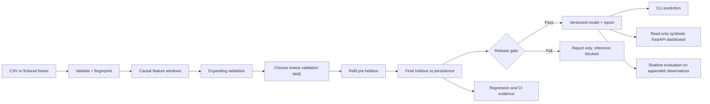

# MarketPulse ML
### Leakage-aware financial time-series forecasting & model operations

**Yasaman Yord · B.Sc. thesis evolution · Python · NumPy · TensorFlow/Keras · FastAPI · MLOps**

[](https://github.com/yasamanyord/Data_Science_Portfolio/actions/workflows/marketpulse.yml)
[](https://www.python.org/)
[](#quick-start)

> A research-grade forecasting workflow with an executable release gate, a versioned model bundle, an offline browser dashboard and API, and operational monitoring — not an automated trading application.

## The problem

My original bachelor's research compared MLP, Simple RNN, GRU, LSTM and stacked LSTM for next-session stock closing-price prediction. Financial time-series models are difficult to evaluate reliably: scaling across train/test can leak future observations, price-level error can hide weak predictive skill, and a complex network may not beat yesterday's close. This upgrade focuses on engineering the whole workflow, measuring those risks, and making each forecast traceable.

**What changed:** the original thesis PDF and historical source are preserved. In the new system, features are causal, transformations fit only on training histories, validation progresses chronologically, an untouched holdout measures the selected configuration, and a failed release gate prevents inference. Model promotion is based on evidence, not a preference for deep learning.

## What works

| Capability | Implementation |
|---|---|
| Data ingestion | Validated, ordered `date,close` CSV; seeded fictional dataset; optional Yahoo Finance acquisition |
| Features | Log returns or returns + moving-average deviations, volatility, RSI |
| Experiments | Persistence, two ridge configurations, optional MLP/RNN/GRU/LSTM/stacked LSTM |
| Evaluation | Three expanding validation folds, temporal 60/20/20 target split, frozen final holdout |
| Quality gate | Candidate must be within 2% of persistence on RMSE, MAE and return MAE; failed forecast blocked |
| Uncertainty | 90% nominal empirical log-return residual band; report measured coverage and width |
| Reproducibility | Dataset fingerprint, fixed demo snapshot, config/split/metrics, integrity-checked JSON/Keras artifacts |
| Inference | Local CLI on matching, unrevised historical series; read-only synthetic REST API |
| Operations | Shadow evaluation of appended observations, regression gate, runbook, CI, container configuration |
| Dashboard | Responsive model comparison, history chart with uncertainty, release status, data lineage |

## Measured results — offline fixture

**These results are from the generated fictional DEMO series, not real AAPL, TSLA or MSFT performance.** 900 observations, 60-observation lookback, 503 initial training targets, 168 validation targets, 168 holdout targets. Data ends 2023-06-13, an intentionally historical fixture.

| Holdout metric | Regularized ridge (selected) | Persistence |
|---|---:|---:|
| RMSE | 1.3621 | 1.4491 |
| MAE | 1.0790 | 1.1548 |
| MAPE | 1.1798% | 1.2640% |
| Sign-match rate | 63.69% | 0.00% |
| Log-return MAE | 1.1801% | 1.2640% |

- Candidate improved RMSE by approximately 6.0% on this designed fixture; **not evidence of an investable strategy**.
- Promotion gate: **PASS**. Nominal 90% band achieved **86.90%** observed coverage, illustrating imperfect uncertainty under shifted volatility.
- Persistence always forecasts no change; its sign-match rate is not a meaningful up/down classifier. Do not interpret the difference as trading accuracy or returns.
- The synthetic data includes deliberately simulated autocorrelation and volatility change. It is a development/verification fixture, **not an independent real-market holdout**.
- Local verification: **35 passing tests, two optional TensorFlow tests skipped**, Node JavaScript syntax check, FastAPI source/API smoke. Browser and Docker execution were not verified locally (browser binary and Docker unavailable). CI includes browser and optional neural validation; check actual Actions status.

Evidence: [experiment report](artifacts/demo/report.json) · [model artifact](artifacts/demo/model.json) · [manifest](artifacts/demo/manifest.json) · [frozen data](artifacts/demo/observations.csv).

## Quick start

No API key, subscription, database, or market data download is required for the offline demo. First-time dependency installation requires internet.

**Windows:** clone/download the repository, open this project directory, then double-click `run_demo.bat`. Or in PowerShell:

```powershell
cd Project_2_Stock_Prediction_DL
python -m venv .venv
.\.venv\Scripts\python.exe -m pip install -r requirements.txt
.\.venv\Scripts\python.exe -m uvicorn marketpulse.api:app --host 127.0.0.1 --port 8000
```

**Linux/macOS:**

```bash
cd Project_2_Stock_Prediction_DL
python3 -m venv .venv
source .venv/bin/activate
python -m pip install -r requirements.txt
python -m uvicorn marketpulse.api:app --host 127.0.0.1 --port 8000
```

Open **http://127.0.0.1:8000**. See the dashboard, compare model selection metrics, filter the holdout chart, inspect the empirical interval and inspect the release gate. Stop with Ctrl+C. API schema: `/openapi.json`; Swagger UI: `/docs` (Swagger assets may require internet).

## Reproduce and test

From this directory:

```bash
python -m marketpulse demo --output runs/reproduction
python -m marketpulse compare --reference artifacts/demo --candidate runs/reproduction
python -m unittest discover -s tests -v
python -m marketpulse predict --artifact artifacts/demo --csv artifacts/demo/observations.csv --ticker DEMO --source "synthetic:seed=42;rows=900"
```

The default demo command reuses the frozen fixture for reproducibility; other seeds or row counts generate different fictional series. Output directories must be new or empty to avoid silently overwriting evidence. A failing gate returns exit code 2 and still records evaluation results; data or configuration errors fail with exit code 1.

To run the full neural comparison, install the optional dependencies and start a new experiment:

```bash
python -m pip install -r requirements-deep.txt
python -m marketpulse demo --deep --epochs 20 --output runs/deep
python -m unittest discover -s tests -v
```

Five Keras architectures are included; the default fixture's verified result uses NumPy ridge. The optional neural execution is not claimed as locally validated. Use CPU by default; different numerical-library/accelerator versions may lead to small metric differences. Check the saved environment metadata.

## Train on historical market data (local research)

Use authorized daily adjusted-close data with one symbol, sorted unique ISO dates and explicit provider lineage. Use completed sessions only; the tool cannot verify exchange-specific holidays, corporate actions or data completeness.

```csv
date,close
2020-01-02,73.449997
2020-01-03,72.855003
```

The lines above illustrate formatting only; a real experiment needs much more history (at least 30 targets per partition).

Optional provider acquisition (provider access and data usage must be permitted):

```bash
python -m pip install -r requirements-data.txt
python -m marketpulse.fetch --ticker AAPL --start 2015-01-01 --end 2023-01-01 --output data/aapl.csv
python -m marketpulse train --csv data/aapl.csv --ticker AAPL --source "Yahoo Finance adjusted close via yfinance" --lookback 60 --features technical --deep --epochs 30 --output runs/aapl-research
```

Install `requirements-deep.txt` as well for `--deep`, or omit that flag for the lightweight baseline models. The downloader uses an explicit end-exclusive date and does not overwrite existing snapshots. Provider availability is not verified; offline normalization is tested with fixtures. For inference with a newly extended CSV, preserve the prior evaluated prefix exactly:

```bash
python -m marketpulse predict --artifact runs/aapl-research --csv data/aapl-extended.csv --ticker AAPL --source "Yahoo Finance adjusted close via yfinance"
python -m marketpulse.monitor --artifact runs/aapl-research --csv data/aapl-extended.csv --ticker AAPL --source "Yahoo Finance adjusted close via yfinance"
```

Neither command places orders. If adjusted history is revised, the supplied file fails integrity checks; create a fresh experiment and review it. Never publish provider data without rights.

## Architecture



The prediction target is the next observed session's log return, converted back to a price using the last known close. The original thesis's direct price-level architecture remains historical, while the upgraded model is trained on returns. A prediction is **one session ahead**, not a guaranteed price and not a trading-day calendar calculation.

## REST API (synthetic demonstration only)

| Endpoint | Response |
|---|---|
| GET / | Browser dashboard |
| GET /health | Service version, mode, promotion status |
| GET /api/report | Evidence and complete holdout records |
| GET /api/forecast | Verified, computed last-snapshot forecast or HTTP 409 if blocked |
| GET /openapi.json | Machine-readable API contract |

Python API runs read-only, starts only with checked synthetic artifacts, and has no write/upload/authentication/trade endpoints. It is not a private-data service; the local CLI is the actual-data interface. The service logs HTTP method, normalized route, status and latency. Exposing a real-data service would need separate access control, review and deployment controls.

## Deploy

```bash
docker compose up --build
```

Compose exposes port 8000 only on localhost, sets a read-only filesystem, drops Linux capabilities and runs a non-root image. Container build/run was not locally verified. For a public portfolio demonstration, use a container host and the same **synthetic** artifact only; deploy with TLS, rate limits, health checks and platform logs. No live hosting has been provisioned. See the [deployment and runbook](docs/operations.md).

## Project structure

```text
Project_2_Stock_Prediction_DL/
  marketpulse/       # data, models, walk-forward evaluation, artifacts, CLI, API, monitoring
  marketpulse/static # responsive browser dashboard; no CDN needed
  tests/             # unit/integration, provider contracts, neural and browser smoke
  artifacts/demo/    # frozen synthetic data, evaluated bundle and checksum manifest
  docs/              # architecture, model card, operations, interview demo
  Scripts/           # original thesis script (historical; not the upgraded execution path)
  other_Models       # historical thesis model notes (not executable Python)
  project description.pdf # original thesis
```

## Portfolio walkthrough & engineering documentation

- [Architecture and test methodology](docs/architecture.md)
- [Model card and limitations](docs/model_card.md)
- [Deployment, monitoring, rollback and production gaps](docs/operations.md)
- [Five-minute demo and interview preparation](docs/demo_script.md)
- [Original B.Sc. thesis PDF](project%20description.pdf)

### Readiness checklist

- [x] Preserve original research and explain methodology changes
- [x] Offline, reproducible data and experiment; causal transforms
- [x] Baseline comparison, holdout gate, artifact integrity and regression checks
- [x] Dashboard, typed JSON API, command-line inference and shadow evaluation
- [x] 35 local tests passing; two optional neural tests written but skipped locally
- [x] Deployment configuration and CI definition
- [ ] Run all five neural models against authorized real-market history
- [ ] Validate on independent walk-forward periods, tickers and market regimes
- [ ] Verify actual data provider availability, calendar and revision handling
- [ ] Confirm GitHub Actions browser/deep/container runs and deploy synthetic demo, if desired
- [ ] Complete security, licensing and operational acceptance before real company use

This is working, production-oriented portfolio software, not a claim of deployed financial forecasting, real-market profitability, or independently audited production readiness. **Research and educational use only.**
