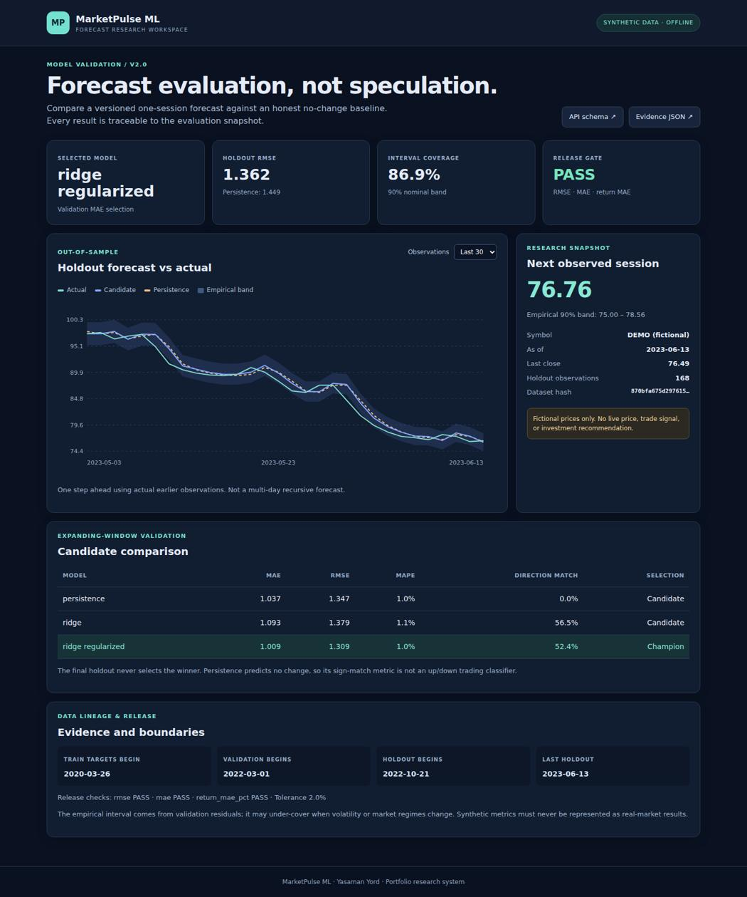
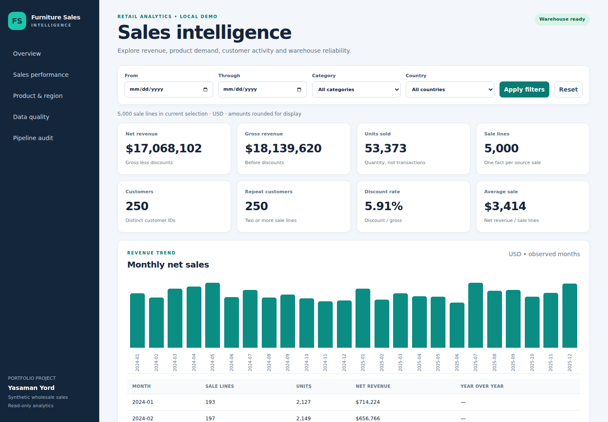

# Yasaman Yord | AI Engineering Portfolio

**AI Engineering · Forward Deployed Engineering · Applied Machine Learning · Data Engineering**

I combine a computer science background with 5+ years of experience in customer support and CRM operations. My focus is building practical AI-powered workflows that solve real business problems — with reliable data, clear application boundaries, measurable evaluations, and usable software.

This portfolio brings together my latest AI application, an upgraded machine-learning research project, and an end-to-end data-engineering system.

## Featured project: BrokerAssist AI

### Human-in-the-loop AI support copilot

**Generative AI · RAG · Agentic workflows · CRM integration · AI safety · Evaluation**

[**Explore the complete BrokerAssist AI repository →**](https://github.com/yasamanyord/brokerassist-ai)

**Business problem:** Brokerage support teams handle repetitive platform, account, payment and verification questions. Routine questions should receive consistent, evidence-based drafts, while sensitive cases require human review and specialist escalation.

BrokerAssist AI turns this workflow into a browser-based support operations application. It retrieves approved policy records, classifies risk, generates grounded drafts, and records human decisions and audit evidence. It supports an offline synthetic demo and a separate, restricted company-pilot configuration.

| Engineering area | Implementation |
| --- | --- |
| Retrieval and LLM integration | Local lexical policy retrieval; optional OpenAI Responses API with bounded, read-only tool calling |
| Workflow and CRM | Ticket intake, inbox, routing, human approval, audit history, signed pilot intake and an optional read-only Zendesk sandbox adapter |
| Safety and reliability | Server-enforced permissions and escalation, output validation, stale-draft protection, provider fallback and idempotency |
| Evaluation | Versioned golden-case baseline, regression gates, mock tool-call probes and adversarial safety scenarios |
| Delivery and operations | FastAPI, SQLite, Docker configuration, CI, deployment runbooks and client acceptance criteria |

**Recorded verification on synthetic development data:** 76 automated tests passed; 50/50 golden cases passed; 20/20 safety scenarios passed; 11/11 mocked LLM contract cases passed. The regression gate passed. These are curated test outcomes, not independent production accuracy or proof of live provider reliability.

**Readiness:** Working local application and restricted pilot implementation. Live LLM and Zendesk validation, independently reviewed evaluations, company-specific security acceptance and live deployment remain pending. No real funds, external replies or account mutations are performed.

**Technical review:** [Architecture](https://github.com/yasamanyord/brokerassist-ai/blob/main/docs/architecture.md) · [Evaluation evidence](https://github.com/yasamanyord/brokerassist-ai/blob/main/evaluations/results.json) · [Safety boundaries](https://github.com/yasamanyord/brokerassist-ai/blob/main/docs/safety_boundaries.md) · [Pilot acceptance](https://github.com/yasamanyord/brokerassist-ai/blob/main/docs/pilot_acceptance.md) · [Interview demo](https://github.com/yasamanyord/brokerassist-ai/blob/main/docs/demo_script.md)

---

## Selected engineering projects

### MarketPulse ML — Financial time-series forecasting & model operations

**ML Engineering · Deep Learning · MLOps · Evaluation · API development**

[**Explore MarketPulse ML →**](Project_2_Stock_Prediction_DL/README.md)

An evolution of my bachelor's thesis comparing neural architectures for next-session stock-price prediction. The upgraded application focuses on reproducible experiments and evidence-based model promotion rather than assuming a complex neural model is always better.

- Causal feature engineering, chronological validation, a frozen holdout and persistence baseline.
- Ridge, MLP, Simple RNN, GRU, LSTM and stacked LSTM experiment support.
- Versioned artifacts, integrity checks, a forecast release gate, empirical uncertainty bands and shadow evaluation.
- Read-only FastAPI service, browser dashboard, container configuration and CI.

**Recorded verification:** 35 local passing tests; GitHub Actions passed offline regression, desktop/mobile browser, Docker and TensorFlow checks. The selected ridge model's RMSE improved by approximately 6% over persistence on the designed fictional fixture — not evidence of real-market performance or an investable strategy. Real-market validation and live deployment remain pending.

[Experiment report](Project_2_Stock_Prediction_DL/artifacts/demo/report.json) · [Model card](Project_2_Stock_Prediction_DL/docs/model_card.md) · [Operations guide](Project_2_Stock_Prediction_DL/docs/operations.md) · [CI evidence](https://github.com/yasamanyord/Data_Science_Portfolio/actions/runs/45823736236) · [Interview demo](Project_2_Stock_Prediction_DL/docs/demo_script.md)

### Furniture Sales Intelligence — Auditable retail data warehouse

**Data Engineering · SQL · Data Quality · ETL · Analytics APIs**

[**Explore Furniture Sales Intelligence →**](Project_1_Data_Warehous/README.md)

An end-to-end analytics application evolved from my original dimensional-modeling project. It turns recurring sales CSV deliveries into an auditable star schema with trustworthy reporting.

- Transactional incremental loads, duplicate detection, source lineage and exact monetary calculations.
- SQL joins, window functions, KPI definitions and independent source reconciliation.
- Filterable browser dashboard, read-only FastAPI endpoints and monthly export for Power BI.
- Data-quality gates, regression checks, backup/restore verification and CI.

**Recorded verification:** 51 automated tests passed; 10/10 independent quality checks passed; the 50,000-row synthetic scale probe and duplicate-replay check passed; GitHub Actions passed tests/regression, desktop/mobile browser and Docker smoke. This is a local synthetic-data application, not a deployed enterprise warehouse.

[Architecture](Project_1_Data_Warehous/docs/architecture.md) · [Validation evidence](Project_1_Data_Warehous/evidence/validation.json) · [Client acceptance](Project_1_Data_Warehous/docs/acceptance.md) · [CI evidence](https://github.com/yasamanyord/Data_Science_Portfolio/actions/runs/45825862505) · [Interview demo](Project_1_Data_Warehous/docs/demo_script.md)

---

## Engineering capability map

| Capability | Evidence in this portfolio |
| --- | --- |
| Business discovery and workflow design | BrokerAssist AI: support requirements, risk routing and pilot acceptance |
| LLM application engineering | BrokerAssist AI: retrieval, constrained tool calling, human review and regression gates |
| Integration and backend engineering | FastAPI, ticket/webhook intake, CRM sandbox adapter, read-only inference and analytics APIs |
| Machine learning and evaluation | MarketPulse ML: time-series experiments, baseline comparison, model promotion and monitoring |
| Data engineering and governance | Furniture Sales Intelligence: incremental ETL, dimensional modeling, lineage and reconciliation |
| Quality, safety and reliability | Automated unit/integration tests, negative controls, release gates and CI evidence |
| Deployment and client handoff | Docker configuration, operational runbooks, deployment constraints and acceptance checklists |

## Technical stack demonstrated

| Area | Technologies and methods |
| --- | --- |
| Software engineering | Python, FastAPI, REST APIs, HTML/CSS/JavaScript, Git |
| Applied AI | OpenAI Responses API (optional), lexical retrieval/RAG, bounded tool calling, deterministic guardrails, human-in-the-loop review |
| Machine learning | NumPy, TensorFlow/Keras, ridge regression, RNN, GRU, LSTM, time-series validation |
| Data engineering | SQL, SQLite, dimensional modeling, incremental ETL, data quality, CSV contracts |
| Integrations & analytics | CRM/Zendesk sandbox adapter, webhooks, JSON APIs, Power BI-compatible exports |
| Testing & delivery | Python unittest, Playwright, GitHub Actions, Docker, regression evaluations and operational documentation |

## How to review this portfolio

1. **Start with BrokerAssist AI** for an AI Engineer / Forward Deployed Engineer interview. Run the offline ticket workflow, inspect an evidence-grounded draft, then test a sensitive case and explain why it escalates.
2. **Explore MarketPulse ML** for experiment design, leakage prevention, model evaluation and release gates.
3. **Explore Furniture Sales Intelligence** for dependable data pipelines, SQL, analytics APIs and reproducible business reporting.

Each project includes local setup instructions, architecture, test evidence, limitations and a demonstration guide. All three can be explored with synthetic data; no paid API key is required for their offline demonstrations. They run separately and may need different local ports if started together.

## Current engineering focus

- Validate live LLM and CRM sandbox integrations with authorized access and reviewed synthetic cases.
- Expand independently authored, multilingual and adversarial evaluations.
- Strengthen production deployment, security, monitoring and client acceptance evidence.
- Validate machine-learning experiments on authorized real-world datasets.

These are next milestones, not claims of completed production work. The portfolio documents implemented functionality and recorded verification separately from untested deployment assumptions. The projects are engineering demonstrations and research, not financial advice or live commercial deployments. No production customer outcomes are claimed.

## Background & opportunities

My customer support and CRM experience informs how I scope software: identify repetitive work, define measurable acceptance criteria, protect sensitive workflows, and document how a team can operate the solution. I am targeting roles where applied AI, software engineering and customer-facing implementation meet.

**Target roles:** AI Engineer · Forward Deployed Engineer · Applied AI Engineer · ML Engineer

**Contact:** [yasaman.yord@gmail.com](mailto:yasaman.yord@gmail.com) · [GitHub profile](https://github.com/yasamanyord)
